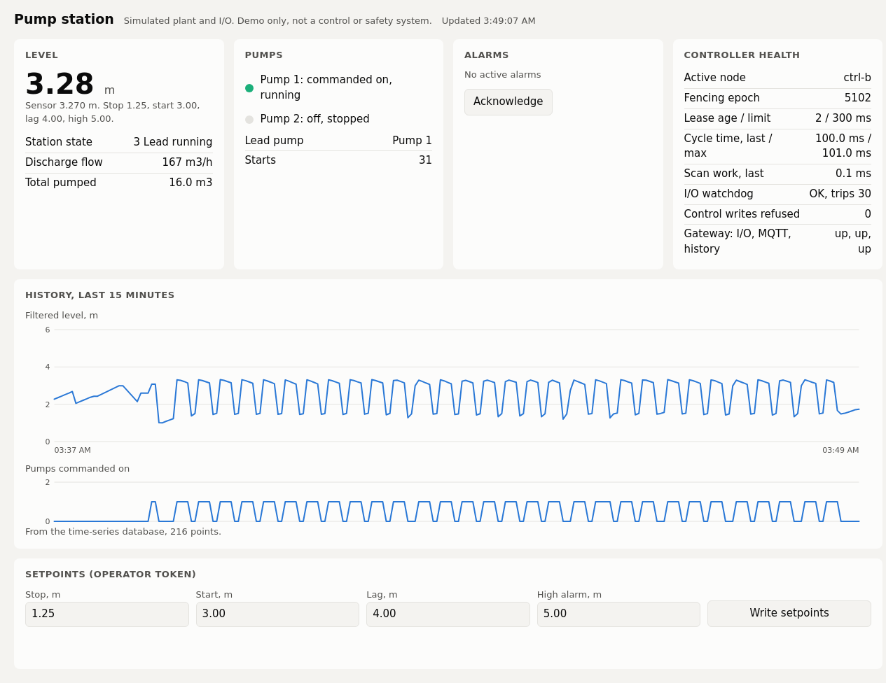

# st2fb: verified PLC migration to IEC 61499

st2fb converts IEC 61131-3 Structured Text into IEC 61499 Basic function blocks, runs them on [Eclipse 4diac FORTE](https://github.com/eclipse-4diac/4diac-forte), and checks every scan against an independent reference compiler, [matiec](https://github.com/beremiz/matiec). A rule-based translator or an LLM can propose a block, and both go through the same check.

```
program.st --(translator or LLM)--> X.fbt --> FORTE ----> trace
     \---------------------------- matiec ----> trace --> compare --> report
```

The repo also holds a pump-station demo, simulated on one PC, that runs a migrated block as a containerized controller with failover.



## Results

| Test | Result | Evidence |
| --- | --- | --- |
| Rule-based translator, 21 baseline programs | 21 of 21 match the reference, on tuning and held-out inputs | `results/verify_2026-11-06/` |
| Sonnet 5.5, same 21 programs, 3 runs each | 60 of 63 first try; 62 of 63 with repair, or 61 under today's stricter parser | `results/benchmark_2026-11-06/` |
| Sonnet 5.5, 27 harder programs, 1 run each | 25 first try; 27 of 27 with repair | `results/hard_2026-11-07/` |
| Harder programs rejected by both rule-based tools | 9 of 9 match with the model | `docs/HARD_CORPUS.md` |
| Real IEC 61499 state machines on request | 3 of 4 pass a static metric | `results/hard_2026-11-07/ecc_persistent/` |
| Injected faults, harder set, reference runs | 1,650 of 1,756 detected | `docs/HARD_MUTATION_RESULTS.md` |
| Injected faults, baseline set, sampled on FORTE | 98 of 105 detected | `docs/FBT_MUTATION_RESULTS.md` |
| Pump station, 30 forced controller failures | Mean control gap 354-364 ms, maximum 421 ms, no dual drive | `docs/EDGE.md` |

## Limits

- The test programs are mostly self-written, so this is not an independent benchmark. Only 4 come from public sources, and those are adapted.
- Siemens-style and Logix-style programs were never compiled in TIA Portal or Studio 5000. The reference for them is a hand-written ST translation, and the Rockwell set is a Logix-flavoured dialect with invented instructions.
- This does not show the model beats deterministic code. A real compiler could also handle the programs that the rule-based tools here reject.
- The prompts include dialect rules and timer guidance. The harder set was run once per program.
- This uses open-source Eclipse 4diac, not EcoStruxure Automation Expert.
- The pump station is a simulation. ESP32 firmware is compiled but never flashed, and nothing has run on a Raspberry Pi. It has no TLS or Modbus authentication, and it is not a control or safety system for real plants.

## Run it

Needs Python 3.10 or newer and Docker. The first run builds the images, which takes several minutes.

```bash
python3 -m st2fb.translate corpus/00_latch/program.st --out build/00_latch/LATCH.fbt
python3 -m st2fb.forte_run --fbt build/00_latch/LATCH.fbt --stimulus corpus/00_latch/stimulus.json --out build/00_latch/forte.json
python3 -m st2fb.reference_run --st corpus/00_latch/program.st --stimulus corpus/00_latch/stimulus.json --out build/00_latch/matiec.json
python3 -m st2fb.compare build/00_latch/matiec.json build/00_latch/forte.json --out build/00_latch/report.json

python3 scripts/verify_corpus.py          # all 21 baseline programs
python3 -m unittest discover -s tests     # about 20 minutes
edge/run_tests.sh                         # pump-station stack
```

Model runs are optional and cost money. They need `--live`, `--budget-usd` and your own key: see `docs/LLM.md`.

## Layout

| Path | Contents |
| --- | --- |
| `st2fb/` | Parser, translator, exporter, runners, comparison, mutation, LLM layer |
| `corpus/`, `corpus_hard/` | Test programs and stimuli |
| `edge/` | Pump-station demo |
| `results/` | Saved benchmark results and logs |
| `docs/` | Design, method and detailed results |

## Licence

MIT licence. See `LICENSE` and `NOTICE.md`.
