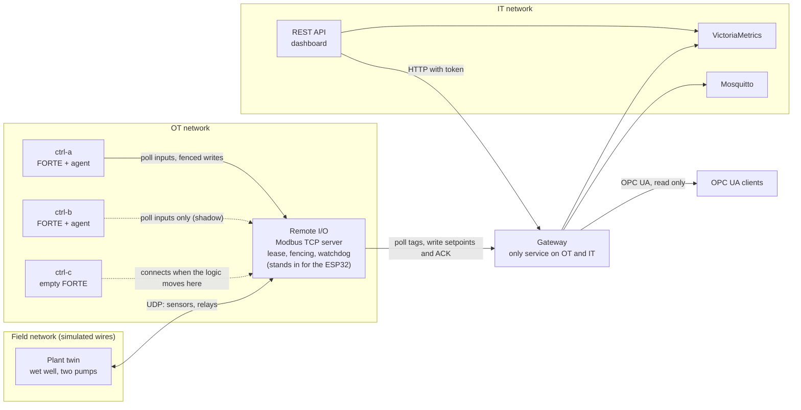

# st2fb edge demo: a software-defined pump station

A water pumping station where the migrated `PUMP_STATION_SUPERVISOR` function block runs on real Eclipse 4diac FORTE, as a controller in a container, talking to remote I/O and to IT systems. It comes with measured failover, fencing, logic migration and fault injection.

**Everything measured here is simulated on one x86_64 PC.** The plant is a Python model, the remote I/O is a Python Modbus server (or the firmware logic compiled for Linux), and the network is Docker bridges. Nothing ran on a Raspberry Pi or an ESP32. FORTE, the FBs, the Modbus traffic and the process kills are real.

## Safety note

This is a demo and a learning project. It is **not a certified control or safety system** and has had no safety review. Do not connect it to mains voltage or to a real plant without review by a qualified person. The hardware path below uses LEDs or small low-voltage relay modules with an isolated supply, and nothing else.

## Status at a glance

| Part | Status |
| --- | --- |
| FORTE controller, plant, remote I/O, MQTT, OPC UA, REST, dashboard, TSDB | Ran, simulated, x86_64 |
| Jitter, failover, fencing, migration, fault tests | Ran, simulated, numbers below |
| Firmware decision logic (`lib/io_core`) | Compiled for Linux and ran here, including closed loop with FORTE. Not on an ESP32 |
| ESP32 firmware image | Compiled in a container. **Not flashed, never run on a chip** |
| arm64 controller image | Built with buildx under QEMU. Ran under QEMU emulation in the simulated loop as a smoke check. **Not run on a Pi** |
| Raspberry Pi deployment (`compose.hardware.yaml`) | **Not run.** `docker compose config` is its only check |
| Wiring | **Not done.** Needs your hands |

## Architecture



| Service | What it is | Image |
| --- | --- | --- |
| `ctrl-a`, `ctrl-b`, `ctrl-c` | FORTE at `efcd63c` plus one patch, libmodbus 3.1.10, the node agent | `controller/Dockerfile`, on `ubuntu:24.04@sha256:fe81…` |
| `remote-io` | Modbus TCP server with the firmware's register map and rules | `sim.Dockerfile`, on `python:3.12-slim@sha256:4840…`, standard library only |
| `plant` | Mass balance, pump dynamics, sensor noise and ADC steps, fault injection | same |
| `gateway` | Modbus to MQTT, OPC UA and TSDB. Only writer of setpoints and ACK | `it.Dockerfile`, pinned pip versions |
| `api` | FastAPI, OpenAPI at `/docs`, dashboard at `/` | same |
| `mosquitto` | `eclipse-mosquitto:2.0.20@sha256:2142…` | upstream |
| `tsdb` | `victoriametrics/victoria-metrics:v1.106.1@sha256:54b2…`, single binary, 32 MB image | upstream |

### Which FORTE modules, and why so few

| Module | Needs | Used |
| --- | --- | --- |
| `com/modbus` (client only; server is a TODO in the source) | libmodbus, apt package | **Yes.** The single addition to the base image's ETH and FBDK |
| `com/mqtt_paho` | Paho C library | No. MQTT in the control runtime would put the broker near the control path. The gateway publishes instead |
| `com/opc_ua` | open62541 >= 1.5.4, not packaged in Ubuntu 24.04, so a source build | No. **OPC UA is provided by the gateway through the Python `asyncua` library.** It is practical and it works, but it is a gateway view of the tags, not FORTE's own OPC UA server |
| `com/HTTP` | none | No. REST belongs in the API service |

The FORTE binary is 1.1 MB, stripped. The final controller image is 118 MB, mostly Python and Ubuntu.

### The FB did fit

`PUMP_STATION_SUPERVISOR` is used unchanged from `corpus/20_pump_station_supervisor/program.st`. Two more FBs written in ST go through the same pipeline and proof (matiec against FORTE, compared scan by scan): `IO_GUARD` turns registers into BOOLs and watches the heartbeat and the sensor, and `OUTPUT_PACK` turns BOOLs into registers. `SCAN_PROBE` is hand-written C++ because it must read a clock, which migrated FBs must not do. `controller/generated/` is checked in and `tests/test_pipeline.py` fails if it stops matching what the pipeline produces.

## The real control data path

This is what flows through FORTE, one application on every node, defined in `controller/agent/app.py`:

```
CYCLE (E_CYCLE, DT = T#100ms)
  EO -> PROBE.REQ -> GUARD.REQ -> SUP.REQ -> PACK.REQ -> GATE.EI (E_PERMIT)
     -> SPLIT.EO1 -> IO.REQ    one FC16: token, pump commands, status, all in one request
     -> SPLIT.EO2 -> PROBE.END
IO (CLIENT_17_13, modbus[tcp:<io>:502:1:50:i0..10,h100..107:h200..219])
  a poll thread inside FORTE reads FC4 and FC3 every 50 ms and refreshes the RD pins
```

- **The loop runs through FORTE.** Input register, FORTE's poll, `GUARD` and `SUP`, one FC16, relay. Python is not in this path apart from the simulated I/O at the far end, and the agent only decides who may write.
- **`SCAN_DT` equals the cycle because both come from one constant** (`SCAN_MS` in `app.py`). `tests/test_stack.py` reads both from the running FBs. It is data: the FB does not know if the cycle was late.
- **Setpoints** travel API, gateway, FC16 to the I/O, then FORTE's poll, then `SUP`. They live at the I/O, so they survive a controller or gateway restart, and the controller never talks to IT.

Four things about FORTE's Modbus layer shaped this design. All come from reading `com/modbus` at the pinned commit:

1. The application gets no signal when polling fails: RD pins simply keep their last value, and write errors are ignored. So `IO_GUARD` needs a heartbeat register to detect a dead link.
2. A BOOL takes one byte in the layer's data block, which misaligns with 16-bit registers, and each address range becomes its own request. So all outputs are UINT or REAL in one flat range, which also makes the write atomic with its fencing token.
3. The address must be a dotted IP, not a host name (`isIp`), so the agent resolves it first. The timeout parameters in the ID string are compiled out (`#if 0`), so libmodbus's default 500 ms applies.
4. The write is a blocking call on the event chain thread. A dead link therefore delays the cycle: see the measured link-loss numbers.

### Real-time behaviour, measured

Measured 2026-11-07 on Intel(R) Core(TM) i7-8750H CPU @ 2.20GHz, 12 logical CPUs, Linux 6.8.0-138-generic (PREEMPT_DYNAMIC, not a real-time kernel), Docker 28.0.0, 300 s per condition. "Jitter" is the absolute difference between a measured cycle and the nominal 100 ms. Load was 3.81 at the start of the first condition. Another agent was using the machine on and off during these runs, so "normal" is not idle.

| Condition | Measured at | Cycles | Mean ms | Min ms | Max ms | Jitter median us | p95 us | p99 us | Max us |
| --- | --- | --- | --- | --- | --- | --- | --- | --- | --- |
| Normal background load | Inside FORTE | 2997 | 100.000 | 97.83 | 102.06 | 343 | 941 | 1224 | 2173 |
| Normal background load | At the I/O | 3001 | 100.000 | 97.77 | 102.04 | 344 | 970 | 1251 | 2230 |
| 12 busy processes | Inside FORTE | 2999 | 100.000 | 93.98 | 105.69 | 346 | 843 | 2984 | 6020 |
| 12 busy processes | At the I/O | 3001 | 100.000 | 92.13 | 107.56 | 361 | 998 | 3210 | 7874 |
| 12 busy processes, FORTE on SCHED_FIFO | Inside FORTE | 2994 | 100.000 | 99.06 | 100.94 | 465 | 620 | 716 | 944 |
| 12 busy processes, FORTE on SCHED_FIFO | At the I/O | 3002 | 100.000 | 94.75 | 104.41 | 472 | 662 | 1289 | 5253 |

- **Inside FORTE** is `SCAN_PROBE`'s `CLOCK_MONOTONIC` timestamp when the cycle event is served. **At the I/O** is the arrival of the FC16 in the Python server, which adds TCP and Python scheduling.
- **Late cycles:** none over 110 ms in any condition. No false takeover or watchdog trip either: `grants` and `wd_trips` were 0 in all 8990 cycles.
- **Drift:** FORTE's timer catches up, so the virtual clock (scans times `SCAN_DT`) stayed within 0.99 ms of real time over about 300 s.
- **Scan work** (cycle event to end of the blocking FC16): median 169 us, p99 438 us, max 1716 us normally; max 6016 us under load.
- **`SCHED_FIFO`** cut FORTE's worst cycle under CPU load from 6.0 ms to 0.9 ms of jitter, and the kernel reported all FORTE threads as `SCHED_FIFO`. The simulated I/O stays on normal scheduling, which probably explains why its own worst figure stays high.
- **Resolution:** FORTE's timer thread sleeps and steps a 1 ms tick, which is the same order as the medians above.

These are measurements of a 100 ms cycle on a fast PC. They are not a bound, and they do not predict a Pi.

The difference from the virtual clock is sharpest when the I/O link dies. Then the blocking Modbus calls stall the event chain, and E_CYCLE's events queue up and run back to back afterwards. Measured during a 36-cycle outage (latest run, `edge/results/faults.json`): longest cycle 984 ms, shortest 0 ms, while the mean stayed near 100 ms. So FB timers keep their count, but do not keep time. `SCAN_DT` says 100 ms throughout.

### How this differs from the deterministic test

The earlier tests in this repo use a virtual clock: `forte_run` sends one frame per scan and blocks for the reply. To compare, `tests/realtime_vs_deterministic.py` plays the supervisor's own corpus stimulus (1990 scans) through both paths, with a player that writes the inputs to the simulated I/O every 100 ms of wall time.

Measured 2026-11-07, 1990 scans of 100 ms, three runs. Compared signals: `STATE_NO`, `PUMP_1`, `PUMP_2`, `LEAD_IS_2`, `HIGH_ALARM`, `STATION_FAULT`.

| Player start offset | Best lag, scans | Output values compared | Mismatches at best lag | Same state sequence | State changes, deterministic / real time | Reference changes not found | `STARTS`, deterministic / real time | `PULSES`, deterministic / real time |
| --- | --- | --- | --- | --- | --- | --- | --- | --- |
| 0 ms | 1 | 11934 | 112 | no | 94 / 91 | 13 | 23 / 21 | 427 / 430 |
| 33 ms | 0 | 11940 | 2 | yes | 94 / 94 | 0 | 23 / 23 | 427 / 427 |
| 66 ms | 1 | 11934 | 2 | no | 94 / 95 | 0 | 23 / 23 | 427 / 427 |

The offset only shifts the player's start. The true phase against the controller's cycle is not controlled, because the controller restarts for each run.

**The same FB, with the same inputs, did not always give the same result.** Two runs tracked the reference almost exactly, at a lag of 0 or 1 scans. In the first run the path diverged: 13 reference state changes had no match, and `STARTS` ended at 21 against 23. Its first unmatched change comes right after a one-scan `TRIP_2` pulse at scan 577, which fits a missed pulse. The run does not record enough to prove that. The stimulus is harsh on purpose, with 19 one-scan pulses: a real signal this short would not reach a PLC reliably either.

Differences that matter:

- **Sampling is asynchronous.** In the test each scan sees exactly its inputs. In real time a scan sees whatever the last poll fetched, so input age varies between 0 and one poll, and outputs can move a scan earlier or later than the reference.
- **A one-scan pulse can be missed or stretched,** because nothing aligns the source of a pulse with the poll and the cycle. The I/O therefore holds ACK for 500 ms, and field trips should be latched at the source. The corpus stimulus has one-scan `TRIP` and `ACK` pulses, which is why the comparison above is a useful stress.
- **There is no process image.** `ecet.cpp` moves external events into the queue between any two event deliveries, so a poll update can land between `GUARD.REQ` and `SUP.REQ`, and the two FBs can see different samples in one scan. Reading the source shows this is possible; I did not measure how often it happens. A PLC's input image prevents it. Here its effect is bounded by one poll.
- **FB timers count scans, not time.** `TON` inside the FB adds `SCAN_DT` per scan. If scans come late, its timers run slow by the same amount, and nothing corrects them. See the virtual-minus-real column above, and the stretched cycles during link loss.
- **The filter and totalizer assume the nominal cycle** for the same reason.

## Failover

`ctrl-a` and `ctrl-b` both run the whole application on live inputs. The standby's `E_PERMIT` gate is closed, so it writes nothing (shadow mode).

### Why two controllers cannot drive outputs at once

The only thing that can move a relay is the remote I/O. It accepts an output block only if the block's first register equals the current lease epoch. This is a **fencing token**, enforced at the actuator, on a single thread (one `loop()` on the ESP32), so each request is atomic.

1. **Lease.** A node requests with FC16 `[node, expected_epoch]` to register 90. The I/O grants only if the lease is free (no accepted control write for `LEASE_TTL_MS`, or released) and the expected epoch matches, then adds one to the epoch. This is a compare-and-swap, so two contenders cannot both win.
2. **Liveness comes from the scan, not from a heartbeat process.** Only accepted control writes refresh the lease. A hung FORTE loses it even if its agent is healthy.
3. **Fencing.** A node that wakes up after being frozen still writes its old token. The I/O refuses it with exception 6, whatever the node believes.
4. **Gate.** The agent closes the gate when it sees the epoch has moved. This is a courtesy, to stop the noise. Safety does not rely on it, and the split-brain test bypasses it on purpose.
5. **Reboot.** The first epoch is random, so a token from before an I/O reboot cannot match by accident.

The trade-off is that the remote I/O becomes the authority. That is acceptable here because it is already a single point of failure: it owns the relays.

**What fencing is not:** authentication. Modbus TCP has none. A stale controller is refused, but anyone on the OT network can read the current epoch and write with it. The defence against that is network segmentation, which is the next limitation to fix.

### Results

Measured 2026-11-07, same machine, simulated, load about 4.24 to 2.9. Each repetition runs `docker kill --signal KILL` on the active container, then restarts it as the new standby. Half of the repetitions kill during pumping and half while waiting. Times come from the I/O's event log and share one clock. The control gap is the cleanest number, because the `docker kill` command itself takes up to 2.0 s to return and the kill lands at some unknown point within that.

**Configuration A, hold last** (watchdog 1000 ms, lease 300 ms, 30 repetitions). Outputs keep the last command for a bounded time, so a fast takeover causes no interruption.

| ms | n | mean | median | p95 | max |
| --- | --- | --- | --- | --- | --- |
| Last write of old node to first write of new node (**control gap**) | 30 | 364 | 364 | 403 | 421 |
| Last old write to lease grant (detection) | 30 | 312 | 313 | 320 | 321 |
| Grant to first new write (activation) | 30 | 52 | 47 | 91 | 101 |
| `docker kill` issued to first new write | 30 | 490 | 476 | 601 | 627 |

**Configuration B, safe first** (watchdog 200 ms, lease 300 ms, 30 repetitions). The watchdog always trips before a new owner can exist.

| ms | n | mean | median | p95 | max |
| --- | --- | --- | --- | --- | --- |
| Last write of old node to first write of new node (**control gap**) | 30 | 354 | 350 | 399 | 410 |
| Last old write to lease grant (detection) | 30 | 311 | 311 | 319 | 320 |
| Grant to first new write (activation) | 30 | 43 | 40 | 85 | 98 |
| `docker kill` issued to first new write | 30 | 499 | 499 | 582 | 730 |

| Plant effect | A, hold last | B, safe first |
| --- | --- | --- |
| Repetitions with a pump running at the kill | 15 | 15 |
| ... with the same pump command in the first new write (bumpless) | 15 | 15 |
| ... with the supervisor state unchanged in the first new write | 15 | 15 |
| Watchdog trips | 0 | 30 |
| Outputs safe before the first new write | 0 of 30 | 30 of 30 |
| Pump command removed, pumps running: mean, max | 0 ms, 0 ms | 145 ms, 180 ms |
| Running pump's speed drop, max (pump inertia, tau 2.5 s) | 0% | 7% |
| Level rise from takeover start, pumps running: max | 0 mm | 0 mm |
| Highest level in the run (high alarm is at 5.0 m) | 3.32 m | 3.32 m |
| Overflow | no | no |
| Dual-drive violations | 0 | 0 |
| `TOTAL`, `PULSES` or `STARTS` went backwards | 0 | 0 |

- **Safe state.** In B, the outputs are forced off and stay off from the trip until the new owner's first write, in every repetition. A holds the last command instead, so it is never forced safe in a fast takeover, and the watchdog limits how long a dead controller's last command can last. Which one is right depends on the process. Stopping a pump for 200 ms costs little here.
- **Level.** With pumps running the level kept falling through the takeover. In waiting repetitions the level rises anyway, at about 25 mm/s from inflow, which is not a takeover effect. Had control never returned, level would rise at that rate.
- **Why the gap is about 360 ms:** lease TTL 300 ms plus up to 20 ms of agent polling, then the wait for the next E_CYCLE tick on the standby, which is at most one cycle.

**Explicit two-writer tests.** The check `check_no_dual_drive` runs on the I/O's own log: accepted epochs never go down, and after a grant no older epoch is accepted.

| Experiment | What it does | Result |
| --- | --- | --- |
| Zombie, 5 repetitions | `docker pause` the active, let the standby take over, then `unpause` | 36 stale writes refused, **0 accepted**, 0 violations. Old node gave up in 137 ms (median) |
| Partition, 3 repetitions | Disconnect the active from the OT network, then reconnect | Takeover 628 ms (median, including the docker command). Stale writes accepted: **0**, 0 violations |
| Forced split brain | Force the standby's gate open with a stale token for 3 s, while the active runs | Standby: 30 refused, **0 accepted**. Active: 30 accepted |
| Direct writes | Old, future and zero tokens from a test client | All refused with exception 6 |

**State transfer, measured:** a failure latch (`FAILED_1_Q1`) set on the old node was `TRUE` on the new node and cleared on ACK. A proof failure took 3.19 s with no takeover, and 5.15 s when the controller was killed 1.5 s into the proof: the timer restarted, so the fault came later by about the elapsed part plus the gap. One sample each.

### State: what is transferred, and how

| State | What happens at takeover | How |
| --- | --- | --- |
| `STATE_NO`, `LEAD_IS_2`, `TOTAL`, `PULSES`, `STARTS` | **Transferred**, at most one scan old | In every fenced FC16, read back from the I/O after the grant, loaded with DEV_MGR `WRITE` |
| `FAILED_1`, `FAILED_2` latches, `PENDING` | **Transferred**, at most 200 ms old | No output pin, so the agent reads them through DEV_MGR 5 times a second and writes a fenced checkpoint block |
| `FILTERED_LEVEL`, alarm timer, heartbeat and stuck timers, ACK edge | **Rebuilt** | The shadow computes them from the same inputs |
| Proof timer | **Lost, restarts** | The shadow's copy reflects a state it only imagined, so it is cleared. A takeover during a pump start extends the proof time, by up to the whole `PROOF_TIME`. Measured below |
| Scan count, max cycle time | Per node, restart | Diagnostics |
| Setpoints | **Unaffected** | They live at the I/O |
| Events within the gap | **Lost** | A pulse shorter than the gap is not seen. Totalizer loses up to the gap's worth of flow |

### Moving the logic, the software-defined part

`ctrl-c` is an empty FORTE. The application is a list of management commands, the same protocol the 4diac IDE uses to deploy. `edge/tools/move_logic.py --to ctrl-c` does this:

1. Deploy through DEV_MGR on the target: gate closed, live inputs.
2. Wait until its `GUARD` reports a live heartbeat.
3. Tell the source to hand over: final checkpoint, gate shut, lease released and **reserved for the target**.
4. The target takes the lease, loads the state, opens the gate.
5. Empty the source.

No wire, register or I/O setting changes, and the application hash is the same on every node. The FB types must already be compiled into the runtime on each node, since dynamic type loading is off. So the image is the "device" and the deployment is the application.

Measured 2026-11-07, 30 repetitions, moving between an empty node and the active position, half of them during pumping, with `ctrl-b` still contending.

|  | n | mean | median | p95 | max |
| --- | --- | --- | --- | --- | --- |
| Deploy the application on the empty FORTE, ms | 30 | 3.6 | 3.3 | 4.3 | 8.1 |
| Deploy to shadow healthy, s | 30 | 1.19 | 1.19 | 1.19 | 1.19 |
| Gap between control writes, ms | 30 | 100 | 110 | 156 | 211 |

Across 30 moves: same pump command in the first new write 30 of 30, relay changes in the gap 0, watchdog trips 0, lease granted to the wrong node 0, state continuity failures 0, dual-drive violations 0, and one application hash on all nodes (`dbb940f535ec6d19`). A planned move stays within about one to two cycles, against about 360 ms for an unplanned failure, because no lease has to expire.

The arm64 check below also took over from an amd64 predecessor, so the checkpoint crosses architectures.

## Fault injection

Run with `pytest tests/test_faults.py`. Each test asserts the expected behaviour. "Scan" below means accepted control writes per second, counted at the I/O.

Measured 2026-11-07, 8 tests, all passing. The figures below are from the latest run (`edge/results/faults.json`, 04:03), and `test_faults.py` overwrites that file on every full run. Timings differ from run to run (an earlier run of the same tests gave, for example, an MQTT reconnect of 4.7 s against 0.41 s here), so read them as ranges. The tests assert behaviour, not these numbers.

| Fault, how it is injected | Expected | Measured |
| --- | --- | --- |
| **MQTT broker down:** `docker stop mosquitto` | Scan unchanged, no trips. API up and reports MQTT down. Reconnects unaided | Scan 10.0/s, worst gap 101 ms, 0 trips, 0 grants. Reconnected in 0.41 s |
| **Gateway restart:** `docker stop`, then `start` | Scan unchanged. API returns 503 for tags and writes, then recovers. Setpoints survive | Scan 10.0/s, 0 trips. API data back 2.06 s after start. Setpoints unchanged |
| **TSDB down** | Scan unchanged. History 503, live tags fine | Scan 10.0/s, 0 trips |
| **All IT down:** API, gateway, TSDB, broker | Supervisor still controls the plant | Scan 10.0/s, 0 trips, and it started a pump with no IT running |
| **Sensor stuck:** plant freezes the level reading | After `STUCK_TIME` (10 s): `SENSOR_FAULT` latches, pumps stop, state 0, API alarm. Stays off until ACK, even when the reading moves again | Detected in 10.21 s, all of that verified |
| **Modbus link loss:** `docker network disconnect` of the I/O from OT | I/O watchdog forces outputs off. `GUARD` reports loss. No lease change. Control resumes unaided when the link returns, through a normal pump start | Watchdog at 1012.6 ms after the last write (setting 1000 ms). `COMMS_OK` false 1.23 s after the cut (delayed by the blocking calls). Epoch unchanged. Resumed 0.47 s after reconnect. 36 cycles during the outage, the longest 984 ms |
| **FORTE process crash:** `SIGKILL` to FORTE only | Standby takes over. Agent restarts FORTE and rejoins as standby | Takeover seen 494 ms after the signal. Rejoined, no stale write accepted |
| **Remote I/O restart** | New random epoch, safe outputs. Old token refused. A controller takes a new lease | Back in control 3.5 s after `docker restart`. Token 21905 became 63841. Setpoints return to defaults (a limitation) |

Note the gap between the two watchdogs in link loss: outputs go safe at the I/O regardless of what the controller knows, and the controller's own guard is slower because the event chain is blocked. That is the argument for putting the watchdog at the I/O.

### Footprint

From `results/resources.txt`, one snapshot with everything running (CPU is one sample, percent of one core). The gateway's memory is the outlier: `asyncua` alone peaked at 577 MB of RSS on import, measured separately. On a small Pi, drop OPC UA first. Each controller, with FORTE and the agent, uses about 12 MB.

```
NAME                                 CPU %     MEM USAGE / LIMIT
st2fb-matiec-st2fb-matiec-mqq_11k4   0.00%     644KiB / 15.49GiB
st2fb-edge-ctrl-b-1                  1.98%     11.8MiB / 15.49GiB
st2fb-edge-ctrl-a-1                  2.07%     11.82MiB / 15.49GiB
st2fb-edge-ctrl-c-1                  1.09%     11.66MiB / 15.49GiB
st2fb-edge-remote-io-1               2.76%     19.2MiB / 15.49GiB
st2fb-edge-gateway-1                 0.54%     412.4MiB / 15.49GiB
st2fb-edge-api-1                     0.07%     39.31MiB / 15.49GiB
st2fb-edge-mosquitto-1               0.05%     1.113MiB / 15.49GiB
st2fb-edge-plant-1                   0.56%     14.87MiB / 15.49GiB
st2fb-edge-tsdb-1                    0.34%     85.3MiB / 15.49GiB
```

## REST API and security basics

Routes: `GET /api/v1/{tags,alarms,health,history,setpoints,dashboard,audit}`, `PUT /api/v1/setpoints`, `POST /api/v1/alarms/ack`. OpenAPI is at `/docs` and `/openapi.json`. A test pins the write surface to exactly those two write routes.

- Bearer tokens, viewer or operator, generated by `scripts/bootstrap.py` into `edge/.env`. Compared in constant time.
- Setpoints are validated three times: in the API (types, range, ordering, extra fields refused), in the gateway, and at the I/O. The firmware has the same check.
- All published ports bind to `127.0.0.1`. A test checks this.
- `edge/.env` and `edge/secrets/` are ignored by git, and a test scans every tracked or new file under `edge/` for the generated values. Only `edge/.env.example` is in the repo.
- Containers run read-only, non-root (except the TSDB, which runs as the image's root with every capability dropped), with no new privileges. The `ot`, `field` and `it` bridges have masquerade off, so no route to the internet. A test checks this for a controller.
- MQTT refuses anonymous clients, and the ACL gives the viewer account read-only access. Nothing subscribes to commands from MQTT, so a broker cannot change the process.
- DEV_MGR has no authentication. A test found that FORTE at `efcd63c` binds it to every interface, ignoring the address given to `-c`. `controller/patches/` fixes that with a small patch, so it now listens on the container's loopback only. Migration goes through the agent's token-protected port.

## How to run

Needs Docker with Compose, and Python 3.10+ for the tests.

```bash
cd edge
python3 scripts/bootstrap.py            # generates .env and secrets/
docker compose build                    # several minutes the first time
docker compose up -d
# Dashboard: http://127.0.0.1:8080  Token: API_VIEWER_TOKEN or API_OPERATOR_TOKEN in edge/.env
# API docs:  http://127.0.0.1:8080/docs   MQTT: 127.0.0.1:1883   OPC UA: opc.tcp://127.0.0.1:4840/st2fb/
docker compose down -v                  # stop and remove everything
```

Tests:

```bash
./run_tests.sh          # everything with assertions, 69 tests, about 5 minutes once images exist; leaves nothing running
./run_tests.sh --full   # also the measurements in this document, about an hour; writes results/
python3 firmware/esp32/gen_regmap_h.py --check
firmware/esp32/build_in_docker.sh       # compiles the firmware, flashes nothing
```

Inject a fault by hand. Port 18100 is the plant's sim-control port, which real hardware does not have:

```bash
curl -X POST 127.0.0.1:18100/fault -d '{"sensor_stuck":true}'
docker kill st2fb-edge-ctrl-a-1
.venv/bin/python tools/move_logic.py --to ctrl-c
```

## Register map

Unit id 1, Modbus TCP port 502. Source of truth: `edge/regmap.json`. `firmware/esp32/include/regmap.h` is generated from it and a test fails if they differ. REAL and DINT span two registers, most significant word first.

Input registers (FC4)

| Addr | Name | Type | Meaning |
| --- | --- | --- | --- |
| 0 | `RAW_LEVEL` | REAL | Level sensor (m) |
| 2 | `FLOW` | REAL | Discharge flow (m3/h) |
| 4 | `FB_1` | UINT | Pump 1 running feedback, 0/1 |
| 5 | `FB_2` | UINT | Pump 2 running feedback, 0/1 |
| 6 | `TRIP_1` | UINT | Pump 1 trip, 0/1 |
| 7 | `TRIP_2` | UINT | Pump 2 trip, 0/1 |
| 8 | `AUTO_SWITCH` | UINT | Local panel AUTO switch, 0/1. Not writable from IT. |
| 9 | `HEARTBEAT` | UINT | Increments every I/O tick while the I/O loop runs |
| 10 | `ACK_MIRROR` | UINT | State of coil ACK, so one FC4 read carries all process inputs |
| 16 | `LEASE_EPOCH` | UINT | Fencing token of the current lease |
| 17 | `LEASE_HOLDER` | UINT | Node id holding the lease, 0 = none |
| 18 | `LEASE_AGE_MS` | UINT | ms since the last accepted control write, saturating at 65535 |
| 19 | `WD_TRIPPED` | UINT | 1 = watchdog has forced outputs safe |
| 20 | `OUTPUT_1` | UINT | Relay 1 state after fencing and watchdog |
| 21 | `OUTPUT_2` | UINT | Relay 2 state after fencing and watchdog |
| 22 | `REJECTED` | UINT | Control writes refused by fencing, wraps |
| 23 | `ACCEPTED` | UINT | Control writes accepted, wraps |
| 24 | `WD_TRIPS` | UINT | Watchdog trips since boot |
| 25 | `GRANTS` | UINT | Leases granted since boot |
| 26 | `UPTIME_S` | UINT | Seconds since boot, wraps |
| 27 | `MAP_VERSION` | UINT | Register map version |
| 28 | `WD_TIMEOUT_MS` | UINT | Output watchdog timeout in force |
| 29 | `LEASE_TTL_MS` | UINT | Lease time-to-live in force |
| 30 | `RESERVED_FOR` | UINT | Node id a released lease is reserved for, 0 = none |

Coils

| Addr | Name | Meaning |
| --- | --- | --- |
| 0 | `ACK` | Alarm acknowledge. Set by FC5, cleared by the I/O after ack_pulse_ms. |

Holding registers

| Addr | Name | Type | Block | Meaning |
| --- | --- | --- | --- | --- |
| 90 | `LEASE_REQ_NODE` | UINT | lease_request | FC16 [node, expected_epoch]: compare-and-swap lease request |
| 91 | `LEASE_REQ_EPOCH` | UINT | lease_request |  |
| 92 | `LEASE_REL_NODE` | UINT | lease_release | FC16 [node, epoch, reserved_for]: planned hand-over |
| 93 | `LEASE_REL_EPOCH` | UINT | lease_release |  |
| 94 | `LEASE_REL_NEXT` | UINT | lease_release |  |
| 100 | `STOP_LEVEL` | REAL | setpoints | Default 1.25, range 0.2 to 5.5 |
| 102 | `START_LEVEL` | REAL | setpoints | Default 3.0, range 0.2 to 5.5 |
| 104 | `LAG_LEVEL` | REAL | setpoints | Default 4.0, range 0.2 to 5.5 |
| 106 | `HIGH_LEVEL` | REAL | setpoints | Default 5.0, range 0.2 to 5.5 |
| 200 | `TOKEN` | UINT | control | Fencing token. The whole block is refused unless this equals LEASE_EPOCH. |
| 201 | `PUMP_1` | UINT | control |  |
| 202 | `PUMP_2` | UINT | control |  |
| 203 | `STATE_NO` | UINT | control |  |
| 204 | `LEAD_IS_2` | UINT | control |  |
| 205 | `HIGH_ALARM` | UINT | control |  |
| 206 | `STATION_FAULT` | UINT | control |  |
| 207 | `COMMS_OK` | UINT | control |  |
| 208 | `SENSOR_FAULT` | UINT | control |  |
| 209 | `FILTERED_LEVEL` | REAL | control |  |
| 211 | `TOTAL` | REAL | control |  |
| 213 | `PULSES` | DINT | control |  |
| 215 | `STARTS` | UINT | control |  |
| 216 | `SCAN_COUNT` | UINT | control |  |
| 217 | `LAST_DT_10US` | UINT | control | Last cycle time in 10 us units, 100 ms reads 10000 |
| 218 | `MAX_DT_10US` | UINT | control | Longest cycle time since this application started, 10 us units |
| 219 | `LAST_EXEC_US` | UINT | control |  |
| 230 | `CKPT_TOKEN` | UINT | checkpoint | Fenced like TOKEN. Written by the agent, not by the scan. |
| 231 | `CKPT_FAILED_1` | UINT | checkpoint |  |
| 232 | `CKPT_FAILED_2` | UINT | checkpoint |  |
| 233 | `CKPT_PENDING` | REAL | checkpoint |  |

Function codes: FC1, FC3, FC4, FC5 (coil 0 only), FC16 (whole blocks only). FC6 and FC15 are refused, because a single-register write could otherwise change a block without its token.

## Hardware path

**None of this has been executed on hardware.** Wiring, flashing and the Pi deployment all need your hands.

### 1. Wiring, ESP32 (low voltage only)

Read the safety note first. Power the ESP32 from USB. Use **LEDs**, or a small 3.3 V compatible, opto-isolated relay module with its own isolated supply (separate `JD-VCC`, jumper removed). Switch nothing above low-voltage DC, and nothing connected to mains or a real pump. Never drive a relay coil directly from a GPIO.

| Signal | GPIO | Connect |
| --- | --- | --- |
| Relay or LED 1 | 26 | LED with 330 ohm resistor to GND, or relay module IN1 |
| Relay or LED 2 | 27 | LED with 330 ohm resistor to GND, or relay module IN2 |
| Level (simulated sensor) | 34, input only, ADC1 | Potentiometer wiper. Ends to 3.3 V and GND, **never 5 V** |
| Flow (simulated sensor) | 35, input only, ADC1 | Second potentiometer wiper, as above |
| Pump 1 feedback | 32 | Switch to GND (closed = running). Internal pull-up |
| Pump 2 feedback | 33 | Switch to GND |
| Trip 1 | 25 | Switch to GND (closed = tripped) |
| Trip 2 | 14 | Switch to GND |
| AUTO switch | 13 | Switch to GND (closed = AUTO) |

With no plant, you close the feedback switch within `PROOF_TIME` (3 s) of the LED coming on, otherwise the supervisor reports a failure to prove. Hold the potentiometer still at a rail and `IO_GUARD` will report a stuck sensor after 10 s, as designed: 1 ADC count is about 1.5 mm, well above its threshold, so ADC noise normally keeps it clear.

### 2. Firmware

```bash
cd edge/firmware/esp32
cp include/wifi_secrets.h.example include/wifi_secrets.h   # fill in; git ignores it
./build_in_docker.sh                                        # the compile I ran, see the result below
pio run -t upload && pio device monitor                     # needs PlatformIO, the board and you
```

**Compile result (2026-11-07, in a container, PlatformIO 6.1.16, `espressif32@6.9.0`, Arduino framework, `-Wall -Wextra`): success, no warnings from this project's code.** RAM 45,136 of 327,680 bytes (13.8%), flash 755,501 of 1,310,720 bytes (57.6%). **Not flashed.**

What verifies the logic without a chip: `lib/io_core` has no Arduino code. `test_host/` compiles that same file for Linux. `tests/test_modbus_conformance.py` runs one suite against it and against the Python I/O, using pymodbus as an independent client, and `tests/test_firmware_core_stack.py` closes the loop with real FORTE, the plant and a real controller kill. `src/main.cpp` (Wi-Fi, GPIO, ADC, task watchdog) has only been compiled.

Three layers fail safe: relay pins go low before anything else in `setup()`, `IoCore` forces outputs off when control writes stop for 1000 ms, and the ESP32 task watchdog resets the chip if the loop hangs for 3 s. Expect to tune `LEASE_TTL_MS` (500 ms in the firmware against 300 ms in simulation) on a real bench. Wi-Fi round trips are slower and burstier than a Docker bridge, and that is untested.

Test the watchdog on the bench: with an LED lit, unplug the controller's network and check the LED goes off within about a second.

### 3. Controller on a Raspberry Pi

Needs a 64-bit OS, with Docker installed.

```bash
# On this PC: build for arm64 and copy over. On a Pi 4, building there also works, more slowly.
docker buildx build --platform linux/arm64 -f controller/Dockerfile -t st2fb-edge-controller:efcd63c --load .
docker buildx build --platform linux/arm64 -f it.Dockerfile -t st2fb-edge-it:1 --load .
docker save st2fb-edge-controller:efcd63c st2fb-edge-it:1 | ssh pi docker load
# On the Pi, in a copy of edge/:
python3 scripts/bootstrap.py
IO_HOST=<esp32-ip> docker compose -f compose.hardware.yaml up -d
```

`--load` overwrites the local amd64 tag, so use a different tag if you keep working on the PC. To see the real jitter on a Pi, take `tests/jitter_test.py` as a starting point. Numbers from this PC do not transfer. `compose.hardware.yaml` polls slower by default (`POLL_MS=200`, `AGENT_LOOP_S=0.1`), because the simulation's rate of about 200 Modbus transactions per second across all clients would be far too much for an ESP32 on Wi-Fi.

**arm64 result (2026-11-07, on this x86_64 PC, QEMU user emulation from `tonistiigi/binfmt:qemu-v8.1.5`, registered for the build and removed afterwards):**

- Controller image built: `linux/arm64`, 142 MB. First build took 46 min 18 s while tests were using the machine; a rebuild after changing only the FBs took under a minute.
- IT image built: `linux/arm64`, 193 MB, 5 min 45 s.
- `tests/arm64_qemu_check.py` then ran the arm64 controller image **under QEMU, not on a Pi**, against the simulated I/O and plant. `uname -m` reported `aarch64`, it took the lease, loaded the checkpoint left by the previous controller, and ran the loop to a pump start (`results/arm64_qemu.json`). This shows the binary, the FB registration and the word order work on arm64. Its timing means nothing, so none is reported.

To repeat the build, register the emulator first: `docker run --privileged --rm tonistiigi/binfmt:qemu-v8.1.5 --install arm64`. Remove it with `--uninstall qemu-aarch64`.

## Where the numbers live

`edge/results/`: `jitter.json`, `failover.json` (every repetition), `realtime_vs_deterministic.json`, `faults.json`, `arm64_qemu.json`, `resources.txt`, `dashboard.png`. `scripts/results_tables.py` prints them as tables. All are from runs on 2026-11-07 on the machine named above. The two takeover sets in `failover.json` were re-run after correcting a pump-speed metric, and the file's `notes` say so.

## Limitations

- **All numbers are from one PC, in simulation.** They say nothing about a Pi, Wi-Fi, an ESP32 or a real plant. The network is a local bridge with almost no latency or loss.
- **Not real-time.** The kernel is a stock PREEMPT_DYNAMIC Ubuntu kernel, and FORTE's timer is a sleeping thread with a 1 ms tick. The measured jitter is good here because the cycle is slow and the host is fast. There is no guarantee, and no bound was proven.
- **Tests ran with other work on the machine.** Load is recorded with each run.
- **The agent is Python** and takes part in takeover timing, not in the scan.
- **DEV_MGR writes are not synchronised with the scan.** State load is ordered to limit the effect (`STATE_NO` last), but a scan can land between writes.
- **Takeover time is mostly the lease TTL by design.** Shorter is possible, at a higher risk of a false takeover when jitter spikes.
- **The lease authority and the relays are one box.** The I/O is a single point of failure. Real redundancy needs redundant I/O, which is a different design.
- **Fencing is not authentication**, as said above. There is no TLS on MQTT, the API or OPC UA (security policy None), which is acceptable only because everything binds to localhost. Tokens sit in environment variables, visible to `docker inspect`.
- **Setpoints are not persisted at the I/O,** so an I/O reboot returns them to defaults. Real firmware should store them in NVS.
- **Sensor-stuck detection is simple:** an unchanged value. A sensor that drifts or sticks with noise will pass it. Stopping the pumps on a stuck sensor is itself a judgement call, since a sump may then overflow. A real station needs an independent high-level float.
- **REAL totalizer.** `TOTAL` is single precision, as in the source ST. Small increments are lost at large totals.
- **The plant model is simple:** one level, first-order pumps, no hydraulics. Time constants are chosen so a cycle takes minutes.
- **Apt packages are not version-pinned.** Base images and pip packages are. `/opt/forte/BUILD_INFO` in the image records the libmodbus version used.
- **Hardware is unverified.** The firmware compiles and its logic passes the tests on Linux, but its Wi-Fi handling, ADC scaling and pin choices have never met a chip.

## What each part demonstrates

| Part | Concept |
| --- | --- |
| Migrated FB on FORTE, E_CYCLE, E_PERMIT | IEC 61499 event-driven execution, function block networks, ST to 61499 migration |
| Deploy through DEV_MGR, `move_logic.py`, one application hash | Software-defined automation: hardware-independent logic, deploy and move at runtime, I/O decoupled from control |
| Modbus FB, register map, firmware | Fieldbus integration, remote I/O, data types and word order |
| Lease, fencing token, shadow standby | Controller redundancy, split-brain prevention, bumpless transfer |
| Watchdog at I/O and heartbeat in the FB | Fail-safe design, defined safe state, comms-loss handling on both sides |
| Jitter probe, virtual versus real clock | Determinism, scan-time analysis, the limits of a non-real-time OS |
| Gateway as single conduit, three networks | IT/OT convergence, zones and conduits in the spirit of IEC 62443 |
| MQTT, OPC UA, REST, TSDB | Plant-to-enterprise data flow, unified namespace style tags, historian |
| Allow-listed writes, validation at three layers, audit log | Secure write paths into a control system |
| Fault tests with stated expectations | Commissioning-style verification, FAT mindset |
| Containers, pinned images, arm64, one-command tests | Edge deployment, reproducibility, software engineering practice |
